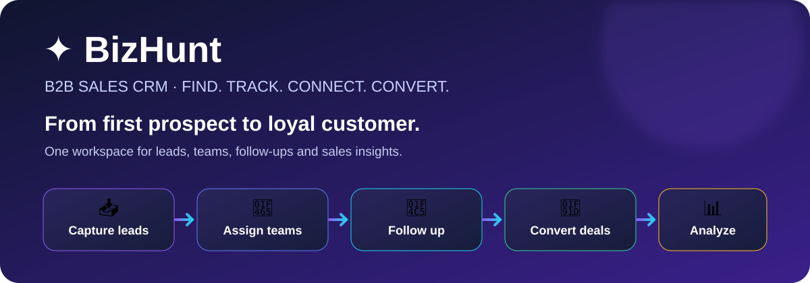
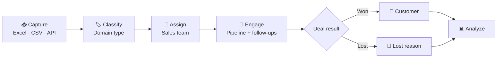
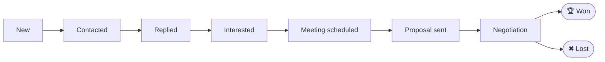
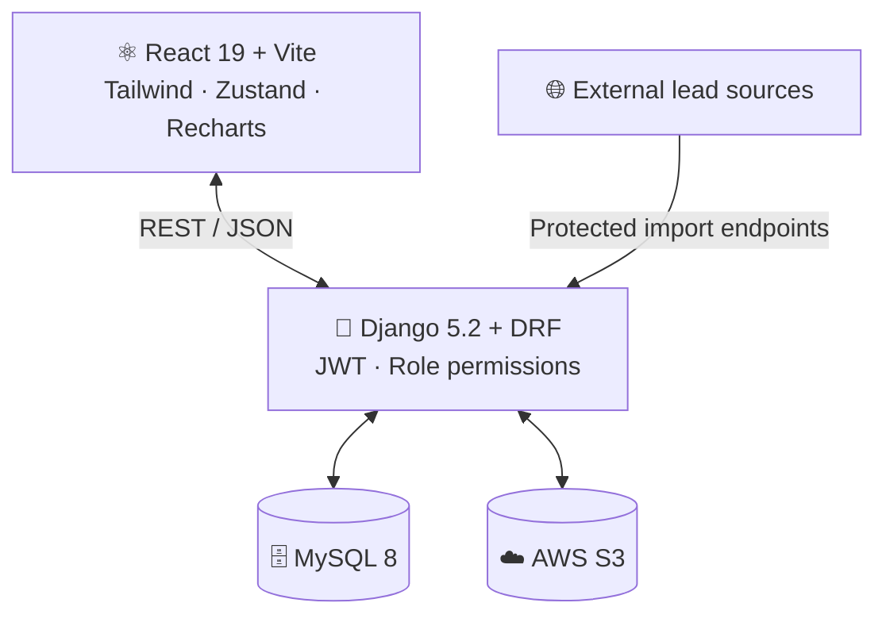

<div align="center">



# BizHunt
### Find. Track. Connect. Convert.

**A B2B CRM to capture leads, organize sales teams, manage follow-ups and convert opportunities into customers.**

[](https://www.djangoproject.com/)
[](https://www.django-rest-framework.org/)
[](https://react.dev/)
[](https://www.mysql.com/)
[](https://www.python.org/)

</div>

---

## ✨ What BizHunt does

| 🎯 Lead management | 👥 Team management | 📅 Follow-ups | 📊 Sales analytics |
|:---:|:---:|:---:|:---:|
| Organize and enrich prospects | Assign leads to the right people | Track the next action | See pipeline and conversions |

## 🔁 From prospect to customer



## 📈 Sales pipeline



| Stage | Meaning |
|---|---|
| 🆕 New → 📞 Contacted | Lead captured and outreach started |
| 💬 Replied → ⭐ Interested | Prospect engages and shows interest |
| 🗓️ Meeting → 📄 Proposal | Discussion and offer |
| 🤝 Negotiation | Commercial terms being discussed |
| 🏆 Won / ✖ Lost | Closed outcome; lost deals require a reason |

## 👤 Three roles. Clear ownership.

| Role | Access |
|---|---|
| 👑 **Super Admin** | Platform-wide users, roles, domains, teams, leads and audit logs |
| 🛠️ **Admin** | Sales users, teams, lead distribution and organization-level insights |
| 🎯 **Lead User** | Assigned leads, notes, follow-ups and customer conversion |

## 🧩 Features

| Feature | What it gives your team |
|---|---|
| 🧠 **Lead intelligence** | Google ratings/reviews, website signals, discovered emails, social links and business images when available |
| 🔎 **Search & filters** | Find leads by business, contact, location, status, domain or assignee |
| 🧹 **Duplicate checks** | Detect repeated leads using email, phone and website details |
| 📥 **Bulk import** | Excel, XLS and CSV imports with column matching and row-level error reports |
| 🔌 **Import API** | Receive JSON or spreadsheet leads from scrapers, forms and other tools |
| 📅 **Follow-up planner** | Email, WhatsApp and call reminders: Overdue, Today and Upcoming |
| 👥 **Lead distribution** | Domain-based teams, unassigned queue, bulk assignment and transfer history |
| 🤝 **Customer conversion** | Convert eligible Won leads into managed customer accounts |
| ☁️ **File workspace** | AWS S3 files, nested folders and secure temporary links |
| 🧾 **Audit trail** | Searchable record of important changes and who made them |

## 📊 What managers can see

| Dashboard metric | Why it matters |
|---|---|
| Total & new leads | Pipeline volume and incoming opportunities |
| Won & lost leads | Sales outcomes |
| Conversion rate | How effectively leads become customers |
| Pipeline stages | Where opportunities are getting stuck |
| Acquisition sources | Which channels bring leads |
| Lost reasons | Why opportunities do not close |
| Team & unassigned counts | Workload and distribution visibility |

## 🏗️ Under the hood



### Technology stack

| Layer | Tools |
|---|---|
| 🖥️ Frontend | React 19 · Vite · Tailwind CSS v4 · React Router v7 |
| 🧠 State & UI | Zustand · Axios · Framer Motion · Lucide React · React Hot Toast |
| 📊 Charts | Recharts |
| ⚙️ Backend | Python 3.12 · Django 5.2 · Django REST Framework |
| 🔐 Security | JWT · Bcrypt · Role-based permissions |
| 🗄️ Database | MySQL 8 · PyMySQL |
| ☁️ Storage & imports | AWS S3 · Boto3 · OpenPyXL |

## 🚀 Run locally

**Prerequisites:** Python 3.12 · Node.js · MySQL 8

### Backend

```bash
cd backend
python -m venv venv

# Windows PowerShell
.\venv\Scripts\Activate.ps1

pip install -r requirements.txt
python manage.py migrate
python manage.py runserver
```

### Frontend

```bash
cd frontend
npm install
npm run dev
```

Configure the environment variables required by your project before starting (database, Django settings, frontend API URL, and optional AWS/import credentials).

> 🔒 Never commit `.env`, passwords, secret keys or cloud credentials. Keep a safe `.env.example` instead.

## 📁 Project layout

```text
BizHunt/
├── backend/       # Django REST API
├── frontend/      # React application
├── assets/        # README visuals
└── README.md
```

*Update the folder names above if your repository uses a different structure.*

---

<div align="center">

### Less spreadsheet chaos. More closed deals.

**BizHunt — Turn leads into relationships. 🚀**

</div>
